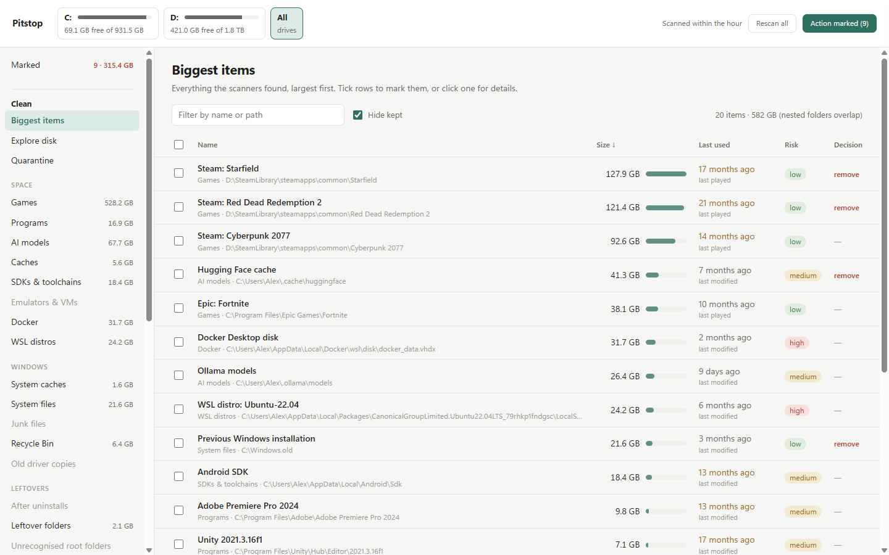
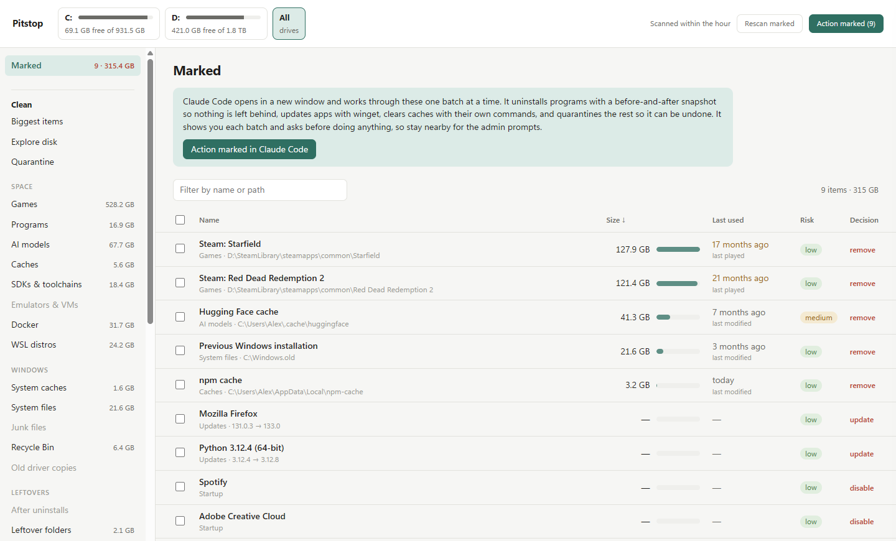
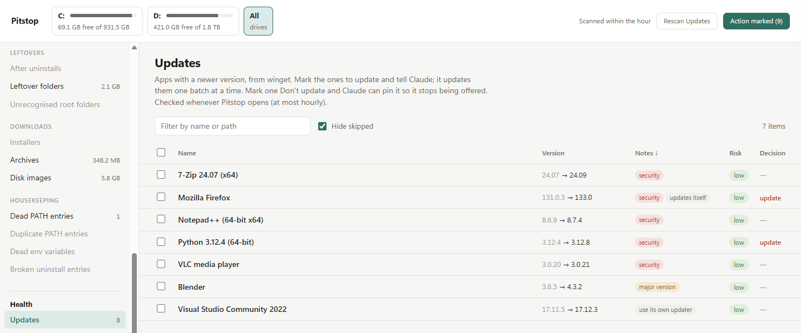
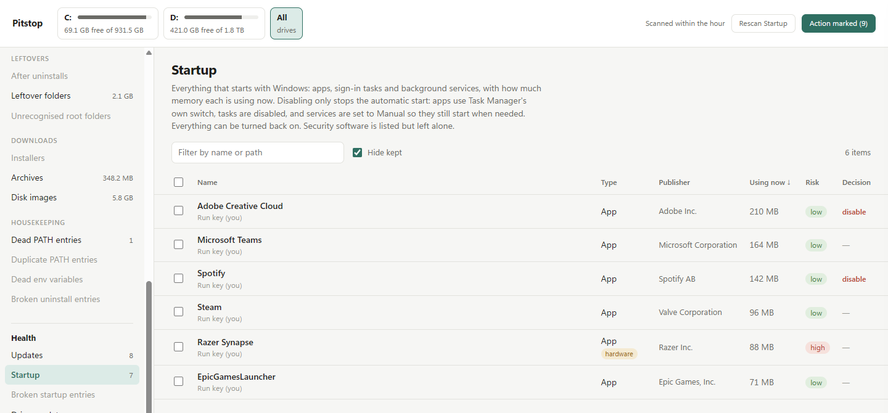
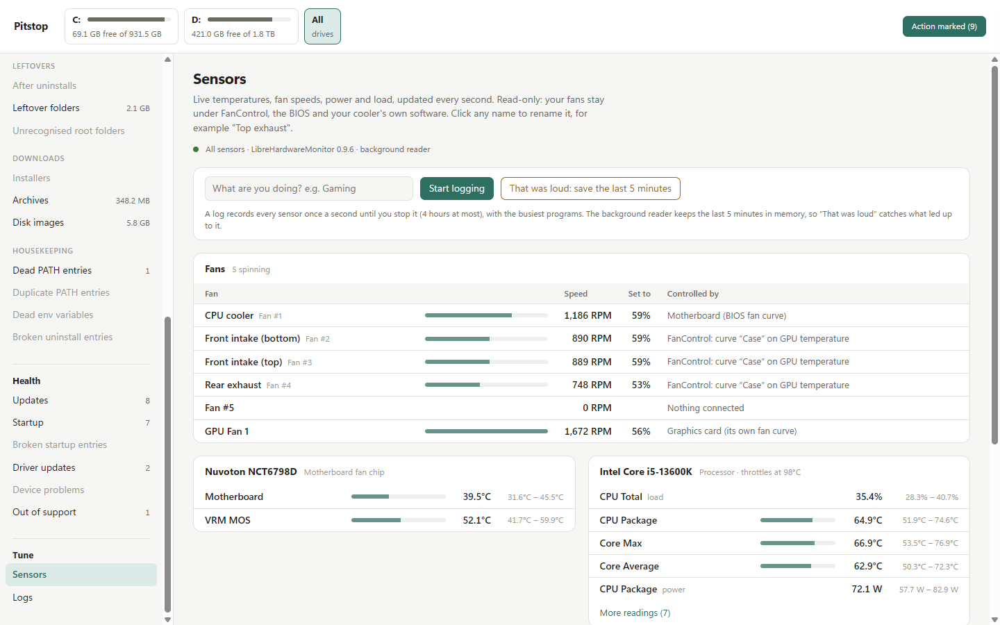
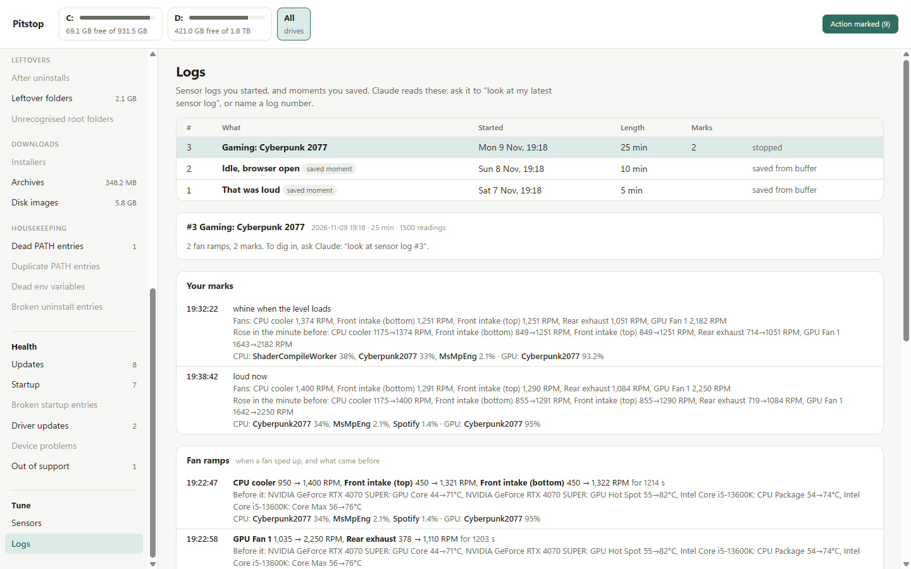
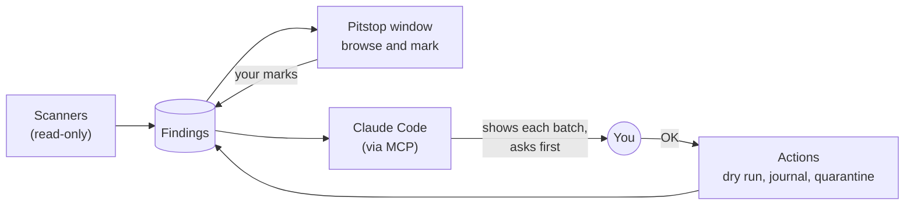

<div align="center">


# Pitstop

**Clean, check and tune your Windows PC, with Claude as your pit crew.**

Pitstop measures. You and Claude decide. Nothing changes without your OK, and almost everything can be undone.


<picture>
  <source media="(prefers-color-scheme: dark)" srcset="docs/images/home-dark.png">
  
</picture>

<sub>Screenshots use demo data.</sub>

</div>

## What it is

Your drive is full, something starts with Windows that you never asked for, and the fans spin up while you're
only browsing. Pitstop finds out why, then talks it through with you in Claude Code. It's built for people who'd
rather understand their PC than click a "Fix 61 issues!" button: no scores, no red gauges, no upsells.

| | Section | What it does |
|---|---|---|
| 🧹 | **Clean** | Finds forgotten space: folders left by uninstalled programs, old SDKs and toolchains, package and AI-model caches, WSL and Docker disks, games you haven't played in years, installers in Downloads, dead PATH entries. Uninstalls properly, cleaning up what a program's own uninstaller leaves behind. |
| 🩺 | **Health** | App updates (through winget), startup items and how much memory each uses, driver updates offered by Windows Update, devices with problems, runtimes past end of support, broken startup entries. |
| 🌡️ | **Tune** | A live view of temperatures, fans, power and load, like HWiNFO. Log a session, mark the moment it gets loud, and Claude explains every fan ramp: which part heated up, and which program was running. |

## See it

<table>
<tr>
<td width="50%">
<picture>
  <source media="(prefers-color-scheme: dark)" srcset="docs/images/marked-dark.png">
  
</picture>
<p align="center"><b>Mark it, then hand it to Claude.</b><br><sub>Tick what should go, update or stop starting. One button opens Claude Code to work through it, a batch at a time.</sub></p>
</td>
<td width="50%">
<picture>
  <source media="(prefers-color-scheme: dark)" srcset="docs/images/updates-dark.png">
  
</picture>
<p align="center"><b>Updates that matter first.</b><br><sub>Security-relevant apps are flagged, major versions are called out, and apps with their own updater are left to it.</sub></p>
</td>
</tr>
<tr>
<td width="50%">
<picture>
  <source media="(prefers-color-scheme: dark)" srcset="docs/images/startup-dark.png">
  
</picture>
<p align="center"><b>What starts with Windows.</b><br><sub>With how much memory each is using right now. Turning one off uses Task Manager's own switch, so it's undoable.</sub></p>
</td>
<td width="50%">
<picture>
  <source media="(prefers-color-scheme: dark)" srcset="docs/images/sensors-dark.png">
  
</picture>
<p align="center"><b>Every fan, and who's driving it.</b><br><sub>FanControl curve, BIOS or graphics card. Name your headers ("Front intake") once and they stay named.</sub></p>
</td>
</tr>
</table>

<details>
<summary><b>More: a sensor log report</b></summary>
<br>
<picture>
  <source media="(prefers-color-scheme: dark)" srcset="docs/images/logs-dark.png">
  
</picture>

Each mark you make while logging ("loud now") is matched with the fan speeds at that second, what rose in the
minute before, and the busiest programs on the CPU and GPU. Claude reads the same report and explains it.
</details>

## Safe by design

- ✅ **Scans only read.** Every action is a dry run until you confirm it.
- ✅ **Quarantine, not delete.** Removed folders are moved aside on the same drive and can be restored. Space is
  freed only when you purge.
- ✅ **Everything is journalled** and can be reversed with `restore <id>`.
- ✅ **A hard deny-list.** Windows, Program Files, your profile folders and drive roots can never be removed.
- ✅ **Owning tools first.** Programs uninstall through their own uninstallers, and caches are cleared by their
  own tools (npm, pip, Docker, WSL).
- ✅ **No registry "cleaning"** and no third-party driver databases. Driver updates come from Windows Update, and
  you tick them yourself.
- ✅ **Tune never sets a fan speed, never talks to USB coolers, and never changes BIOS, voltage or power
  settings.** Fan changes are proposals you make yourself in FanControl or your cooler's software.

More in [docs/DESIGN.md](docs/DESIGN.md) and [docs/HARDWARE.md](docs/HARDWARE.md).

## How it works



Pitstop's scanners only read. What they find goes into a local database, which the Pitstop window shows and
Claude reads through Pitstop's MCP tools. When you say go, Claude runs Pitstop's actions one confirmed batch at a
time, and the window updates live as each item is done.

## Get started

**You'll need**

- Windows 10 or 11
- [Python](https://www.python.org/downloads/) 3.12 or 3.13
- [Claude Code](https://claude.com/claude-code), to have Claude drive it. The window and the command line also
  work on their own.

**Install**

```powershell
git clone https://github.com/Bluemands/Pitstop.git
cd Pitstop
py -3.13 -m venv .venv
.venv\Scripts\python.exe -m pip install -r requirements.txt
.venv\Scripts\python.exe -m pitstop setup
```

`setup` does three things:

1. writes `.mcp.json`, so Claude Code can use Pitstop's tools (it asks you to approve them the first time)
2. adds a **Pitstop** shortcut to the Desktop and Start menu
3. sets up sensors: it uses FanControl's copy of LibreHardwareMonitor if FanControl is installed, otherwise it
   downloads a pinned, hash-checked copy from nuget.org

<details>
<summary><b>For the Tune section (all optional)</b></summary>
<br>

- **.NET Framework 4.8.** It's already part of Windows 10 1903+ and Windows 11.
- **The [PawnIO](https://pawnio.eu) driver**, for CPU temperatures and motherboard fans:
  `winget install namazso.PawnIO`. Without it you still get GPU, drive and CPU-load readings. Pitstop never
  installs a driver itself, and never uses the old WinRing0 driver that antivirus software flags.
- **[FanControl](https://getfancontrol.com)**, if you want Pitstop to read your fan curves.

Full readings need admin. Pitstop starts a small background reader with one UAC prompt, and it stops itself two
minutes after you stop looking.
</details>

## Using it

Open Claude Code in the Pitstop folder and just ask:

> 💬 *"Let's do a cleanup session."*
> Claude scans, shows the biggest items in small batches, and asks about each one.

> 💬 *"Clean up what I marked."*
> Claude works through what you marked in the window, one confirmed batch at a time.

> 💬 *"My fans are loud when they shouldn't be."*
> Claude reads your sensors and fan setup, asks you to log a session, and explains each fan ramp.

> 💬 *"What starts with Windows that I don't need?"*
> Claude walks through your startup items, and turns off the ones you choose.

**The window:** open **Pitstop** from the Start menu. Browse findings, mark them (remove, keep, or review
later), watch live sensors, and start or mark sensor logs. The window only records your decisions. Claude acts
on them, and you watch each item go.

<details>
<summary><b>The command line</b></summary>
<br>

Everything is also available directly. Add `--json` for machine-readable output, or `--elevate` to run one
command as admin.

```powershell
.venv\Scripts\python.exe -m pitstop summary
.venv\Scripts\python.exe -m pitstop scan
.venv\Scripts\python.exe -m pitstop list --category cache
.venv\Scripts\python.exe -m pitstop quarantine <id>            # dry run; add --yes to do it
.venv\Scripts\python.exe -m pitstop hw now
.venv\Scripts\python.exe -m pitstop hw log start --label "Gaming"
.venv\Scripts\python.exe -m pitstop hw report
```
</details>

## Questions

<details>
<summary><b>Does it delete things?</b></summary>
<br>
Not straight away. Folders go to a quarantine folder on the same drive (<code>Pitstop-Quarantine</code>) and can
be restored. They're deleted only when you ask Claude to purge, ideally after you've used your PC for a while
without missing anything. Programs are removed by their own uninstallers.
</details>

<details>
<summary><b>Does it work without Claude?</b></summary>
<br>
Yes. The window and the command line work on their own. Claude adds the judgement: "is this folder from
something you still use?", "why did the fans ramp at 21:14?"
</details>

<details>
<summary><b>Will it change my fan speeds?</b></summary>
<br>
No. Pitstop only reads sensors. When Claude suggests a new fan curve, it gives you the numbers to type into
FanControl or your cooler's software, checked against safe temperature limits, and then you log again to compare.
</details>

<details>
<summary><b>Why does it sometimes ask for admin?</b></summary>
<br>
Some things need it: running an uninstaller, changing an all-users startup entry, removing an old driver copy,
or reading CPU and motherboard sensors. Each one shows a normal Windows UAC prompt, so stay near your PC during a
session.
</details>

<details>
<summary><b>What leaves my PC?</b></summary>
<br>
Pitstop itself has no account, no telemetry and no cloud service. It asks winget and Windows Update which
updates exist, and the sensor setup may download LibreHardwareMonitor from nuget.org. When you work with Claude,
what Claude reads goes through Claude Code, like any conversation.
</details>

<details>
<summary><b>Where is my data, and how do I remove Pitstop?</b></summary>
<br>
Everything Pitstop records (findings, your decisions, the journal and sensor logs) is in the <code>data</code>
folder inside Pitstop. To remove Pitstop, first restore or purge anything still in quarantine, then delete the
Pitstop folder and its Desktop and Start menu shortcuts.
</details>

<details>
<summary><b>Mac or Linux?</b></summary>
<br>
No. Pitstop is Windows only: it reads the registry, Windows Update, winget and Windows' own startup lists.
</details>

<details>
<summary><b>Running the tests</b></summary>
<br>

```powershell
.venv\Scripts\python.exe -m unittest discover -s tests -t .
```
</details>

## Credits

- [LibreHardwareMonitor](https://github.com/LibreHardwareMonitor/LibreHardwareMonitor) (MPL-2.0) for sensor readings
- [pythonnet](https://github.com/pythonnet/pythonnet), [psutil](https://github.com/giampaolo/psutil) and the
  [MCP Python SDK](https://github.com/modelcontextprotocol/python-sdk)
- [PawnIO](https://pawnio.eu) by namazso for safe low-level hardware access

---

<sub>MIT licence, see [LICENSE](LICENSE). Pitstop is provided as is, without warranty. It's careful by design
(dry runs, quarantine, a journal and a deny-list), but it changes real systems when you tell it to, and the
decisions are yours. Keep backups of anything you care about. Advice about fan curves is advice: you own your
hardware and the changes you make to it. Not affiliated with Anthropic, Microsoft, FanControl or any hardware
maker.</sub>
